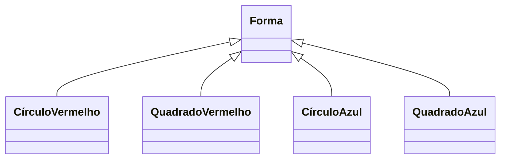
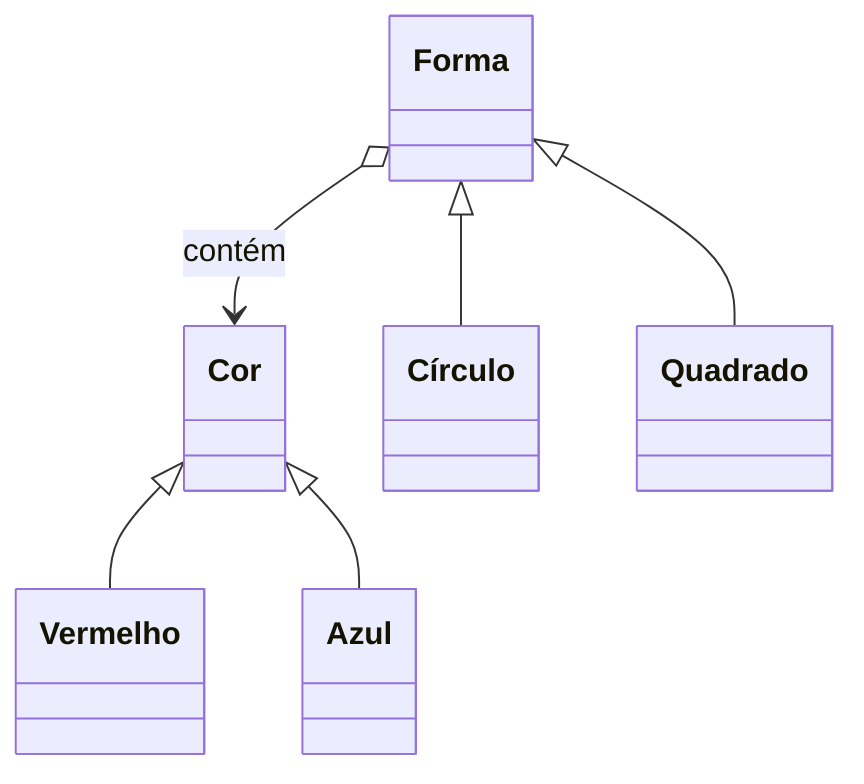
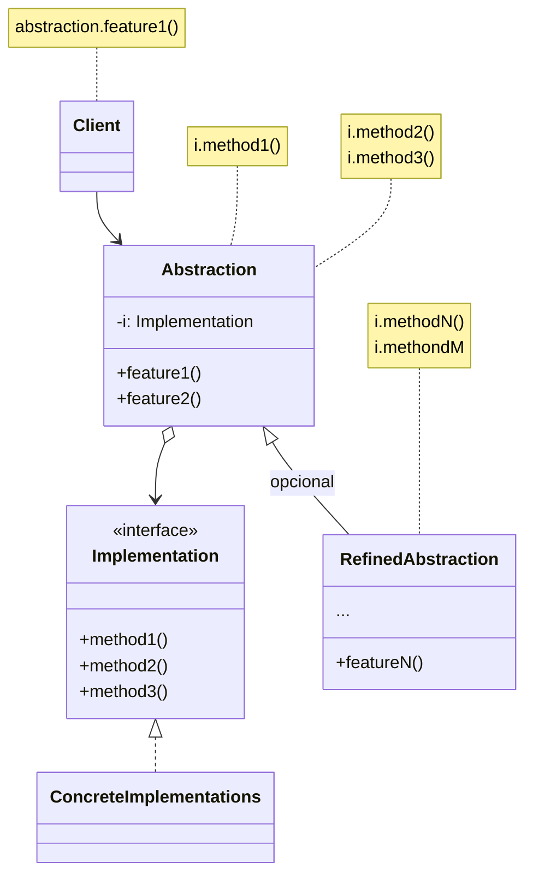

---

tipo: anotacao

periodo: 5

disciplina: Psoft

trilhas:

- Engenharia de Software

---
## Propósito:

O **Bridge** é um padrão de projeto estrutural que permite que você divida uma classe grande ou um conjunto de classes intimamente ligadas em duas hierarquias separadas - **abstração e implementação** - quie podem ser desenvolvidas independentes umas das outras.

## Problema:

Digamos que você tem uma classe `Forma` geométrica com um par de subclasses: `Círculo` e `Quadrado` . Você quer estender essa hierarquia de classe para incorporar cores, então você planeja criar subclasses de forma `Vermelho` e `Azul`. Contudo, já que você já tem duas subclasses você precisa criar quatro combinações de classe tais como `CírculoAzul` e `QuadradoVermelho` .

Adicionar novos tipos de forma e cores à hierarquia irá fazê-la crescer exponencialmente.Por exemplo, para adicionar uma forma de triângulo você vai precisar introduzir duas subclasses, uma para cada cor. E depois disso, adicionando uma nova cor será necessário três subclasses, uma para cada tipo de forma. Quanto mais longe vamos, pior isso fica.

## Solução:

Esse problema ocorre porque estamos tentando **estender as classes de forma em duas dimensões diferentes**: por forma e por cor. Isso é um **problema muito comum com herança de classe**.

O padrão Bridge tenta resolver esse problema ao trocar de herança para composição do objeto. Isso significa que você extrai uma das dimensões em uma hierarquia de classe separada, para que as classes originais referenciem um objeto da nova hierarquia, ao invés de ter todos os seus estados e comportamentos dentro de uma classe.

Para interpretar as setas e os losangos dos diagramas, veja [[Relações entre classes]].

*obs: Você pode prevenir a explosão de uma hierarquia de classe ao transformá-la em diversas hierarquias relacionadas.*

Seguindo essa abordagem nós podemos extrair o código relacionado à cor em sua própria classe com duas subclasses: `Vermelho` e `Azul`. **A classe `Forma` então ganha um campo de referência apontando para um dos objetos de cor.** Agora **a forma pode delegar qualquer trabalho referente a cor para o objeto ligado a cor.** Aquela referência vai agir como uma ponte entre as classes `Forma` e `Cor`. De agora em diante, para adicionar novas cores não será necessário mudar a hierarquia da forma e vice versa.

## Abstração e implementação:

_Abstração_ (também chamado de _interface_) é uma camada de controle de alto nível para alguma entidade. **Essa camada não deve fazer nenhum tipo de trabalho por conta própria.** Ela deve delegar o trabalho para a camada de _implementação_ (também chamada de _plataforma_).

Observe que não estamos falando sobre _interfaces_ ou _classes abstratas_ da sua linguagem de programação. São coisas diferentes. Quando falamos sobre aplicações reais, a abstração pode ser representada por uma interface gráfica de usuário (GUI), e a implementação pode ser o código subjacente do sistema operacional (API) a qual a camada GUI chama em resposta às interações do usuário.

Geralmente falando, você pode estender tal aplicação em duas direções independentes:

- Ter diversas GUIs diferentes (por exemplo, feitas para clientes regulares ou administradores).
- Suportar diversas APIs diferente (por exemplo, para ser capaz de lançar a aplicação no Windows, Linux e macOS).

No pior dos cenários, essa aplicação pode se parecer como uma enorme tigela de espaguete onde centenas de condicionais conectam diferentes tipos de GUI com vários APIs por todo o código.

Fazer até mesmo uma única mudança em uma [[Código monolítico|base de códigos monolítica]] é bastante difícil porque você deve entender _a coisa toda_ muito bem. Fazer mudanças em módulos menores e bem definidos é muito mais fácil.

Você pode trazer ordem para esse caos extraindo o código relacionado a específicas combinações interface-plataforma para classes separadas. Contudo, logo **você vai descobrir que existirão _muitas_ dessas classes. A hierarquia de classes irá crescer exponencialmente porque adicionando um novo GUI ou suportando um API diferente irá ser necessário criar mais e mais classes.**

Vamos tentar resolver esse problema com o padrão Bridge. Ele sugere que as classes sejam divididas em duas hierarquias:

- **Abstração:** a camada GUI da aplicação.
- **Implementação:** As APIs do sistema operacional.

O objeto da **abstração** controla a aparência da aplicação, delegando o verdadeiro trabalho para o objeto de implementação ligado. Implementações diferentes são intercambiáveis desde que sigam uma interface comum, permitindo que a mesma GUI trabalhe no Windows e Linux.

Como resultado você pode mudar as classes GUI sem tocar nas classes ligadas a API. Além disso, adicionar suporte para outro sistema operacional só requer a criação de uma subclasse na hierarquia de implementação.

1. A **Abstração** fornece a lógica de controle de alto nível. Ela depende do objeto de implementação para fazer o verdadeiro trabalho de baixo nível.
2. A **Implementação** declara a interface que é comum para todas as implementações concretas. Um abstração só pode se comunicar com um objeto de implementação através de métodos que são declarados aqui. A abstração pode listar os mesmos métodos que a implementação, **mas geralmente a abstração declara alguns comportamentos complexos que dependem de uma ampla variedade de operações primitivas declaradas pela implementação.**
3. **Implementações Concretas** contém código plataforma-específicos.
4. **Abstrações Refinadas** fornecem variantes para controle da lógica. Como seu superior, trabalham com diferentes implementações através da interface geral de implementação.
5. Geralmente o **Cliente** está apenas interessado em trabalhar com a abstração. Contudo, *é trabalho do cliente ligar o objeto de abstração com um dos objetos de implementação.*
## Aplicabilidade

Utilize o padrão Bridge quando você quer dividir e organizar uma [[Classe monolítica|classe monolítica]] que tem diversas variantes da mesma funcionalidade (por exemplo, se a classe pode trabalhar com diversos servidores de base de dados).

Quanto maior a classe se torna, mais difícil é de entender como ela funciona, e mais tempo se leva para fazer mudanças. As mudanças feitas para uma das variações de funcionalidade podem precisar de mudanças feitas em toda a classe, o que quase sempre resulta em erros ou falha em lidar com efeitos colaterais.

O padrão Bridge permite que você divida uma classe monolítica em diversas hierarquias de classe. Após isso, você pode modificar as classes em cada hierarquia independentemente das classes nas outras. Essa abordagem simplifica a manutenção do código e minimiza o risco de quebrar o código existente.

Utilize o padrão quando você precisa estender uma classe em diversas dimensões ortogonais (independentes).

O Bridge sugere que você extraia uma hierarquia de classe separada para cada uma das dimensões. A classe original delega o trabalho relacionado para os objetos pertencentes àquelas hierarquias ao invés de fazer tudo por conta própria.

Utilize o Bridge se você precisar ser capaz de trocar implementações durante o momento de execução.

Embora seja opcional, o padrão Bridge permite que você substitua o objeto de implementação dentro da abstração. É tão fácil quanto designar um novo valor para um campo.

_A propósito, este último item é o maior motivo pelo qual muitas pessoas confundem o Bridge com o padrão [[Strategy]]. Lembre-se que um padrão é mais que apenas uma maneira de estruturar suas classes. Ele também pode comunicar intenções e resolver um problema._

## Como implementar

1. Identifique as dimensões ortogonais em suas classes. Esses conceitos independentes podem ser: abstração/plataforma, domínio/infraestrutura, front-end/back-end, ou interface/implementação.
2. Veja quais operações o cliente precisa e defina-as na classe abstração base.
3. Determine as operações disponíveis em todas as plataformas. Declare aquelas que a abstração precisa na interface geral de implementação.
4. Crie classes concretas de implementação para todas as plataformas de seu domínio, mas certifique-se que todas elas sigam a interface de implementação.
5. Dentro da classe de abstração, adicione um campo de referência para o tipo de implementação. A abstração delega a maior parte do trabalho para o objeto de implementação que foi referenciado neste campo.
6. Se você tem diversas variantes de lógica de alto nível, crie abstrações refinadas para cada variante estendendo a classe de abstração básica.
7. O código cliente deve passar um objeto de implementação para o construtor da abstração para associar um com o outro. Após isso, o cliente pode esquecer sobre a implementação e trabalhar apenas com o objeto de abstração.

| Prós                                                                                                                                      | Contras                                                                                      |
| ----------------------------------------------------------------------------------------------------------------------------------------- | -------------------------------------------------------------------------------------------- |
| Você pode criar classes e aplicações independentes de plataforma.                                                                         | Você pode tornar o código mais complicado ao aplicar o padrão em uma classe altamente coesa. |
| O código cliente trabalha com abstrações em alto nível. Ele não fica exposto a detalhes de plataforma.                                    |                                                                                              |
| _Princípio aberto/fechado_. Você pode introduzir novas abstrações e implementações independentemente uma das outras                       |                                                                                              |
| _Princípio de responsabilidade única_. Você pode focar na lógica de alto nível na abstração e em detalhes de plataforma na implementação. |                                                                                              |
> [!cite] Fonte:
> https://refactoring.guru/pt-br/design-patterns/bridge
