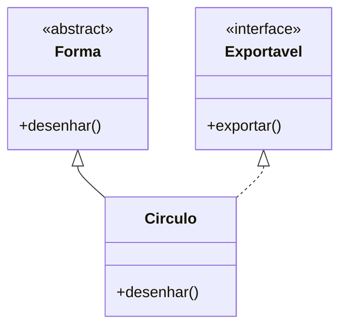

---

tipo: anotacao

periodo: 5

disciplina: Psoft

trilhas:

- Engenharia de Software

---
## Interface:

Uma **interface** define um contrato: quais operações uma classe deve oferecer, sem determinar como ela as executa. No UML, pode aparecer como uma classe marcada com `«interface»` ou como um pequeno círculo ligado à classe que a oferece. No Mermaid das notas, escrevemos `<<interface>>`. A ligação com uma classe que implementa o contrato é uma **realização**: linha tracejada com triângulo vazio apontando para a interface (`<|..`).

## Classe abstrata:

Uma **classe abstrata** é uma base que não deve ser instanciada diretamente. Pode reunir comportamento compartilhado e declarar operações que subclasses precisam completar. No UML, o nome da classe e as operações abstratas aparecem em *itálico*; também se pode indicar `{abstract}`. No Mermaid, `<<abstract>>` explicita a ideia de maneira legível.

## Exemplo:

`Circulo` **herda** de `Forma` (linha contínua e triângulo vazio) e **implementa** `Exportavel` (linha tracejada e triângulo vazio). Uma classe abstrata pode fornecer código comum; a interface descreve o contrato a cumprir.

> [!note] Termos parecidos, sentidos diferentes
> Em [[Bridge]], “abstração” é o lado de alto nível do padrão, e “implementação” é o lado para o qual ele delega. Isso não obriga essas partes a serem uma classe abstrata e uma interface da linguagem.

Veja também: [[Relações entre classes]].
