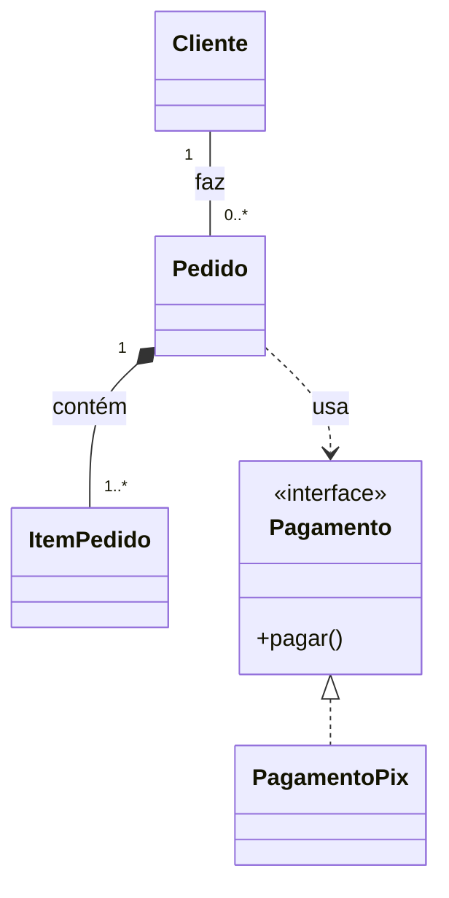

---

tipo: anotacao

periodo: 5

disciplina: Psoft

trilhas:

- Engenharia de Software

---
## Como ler as setas:

Nos diagramas de classes, as linhas mostram **como classes se relacionam**. A tabela usa a sintaxe Mermaid, presente em [[Bridge]] e [[Strategy]]; os símbolos desenhados por ela correspondem às relações UML.

| Relação                 | Símbolo UML                                                   | Mermaid (`classDiagram`)     | Significado                                                                                  |
| ----------------------- | ------------------------------------------------------------- | ---------------------------- | -------------------------------------------------------------------------------------------- |
| Associação              | Linha contínua                                                | `Cliente -- Pedido`          | Objetos se relacionam. Uma seta pode indicar a direção em que um conhece o outro.            |
| Agregação               | Losango vazio no lado do todo                                 | `Time o-- Jogador`           | Relação todo-parte fraca: a parte pode existir sem o todo.                                   |
| Composição              | Losango preenchido no lado do todo                            | `Pedido *-- ItemPedido`      | Relação todo-parte forte: a parte pertence a um único todo e seu ciclo de vida depende dele. |
| Dependência             | Linha tracejada com seta                                      | `Relatorio ..> Impressora`   | Uma classe usa outra pontualmente; uma mudança na segunda pode afetar a primeira.            |
| Herança (generalização) | Linha contínua e triângulo vazio apontando para a classe base | `Animal <-- Cachorro`        | A subclasse é um tipo da classe base e herda suas características.                           |
| Realização de interface | Linha tracejada e triângulo vazio apontando para a interface  | `Pagamento <.. PagamentoPix` | Uma classe implementa o contrato definido pela interface.                                    |

## Exemplo:

Em `Cliente "1" -- "0..*" Pedido`, os números indicam **multiplicidade**: cada pedido tem um cliente; um cliente pode ter zero ou muitos pedidos. O losango fica junto de `Pedido` porque ele é o todo que contém os itens.

> [!note] Associação não é sempre agregação
> Ter uma referência a outro objeto não basta para caracterizar agregação ou composição. Use o losango apenas quando quiser representar uma relação todo-parte; caso contrário, uma associação simples costuma ser suficiente. Em [[Bridge]] e [[Strategy]], `o-->` representa graficamente uma agregação com direção, mas a ideia central dos padrões é a **delegação por composição de objetos** (usar um objeto de outra classe em vez de herdar seu comportamento), não necessariamente a relação UML de composição `*--`.

Veja também: [[Interfaces e classes abstratas]].
