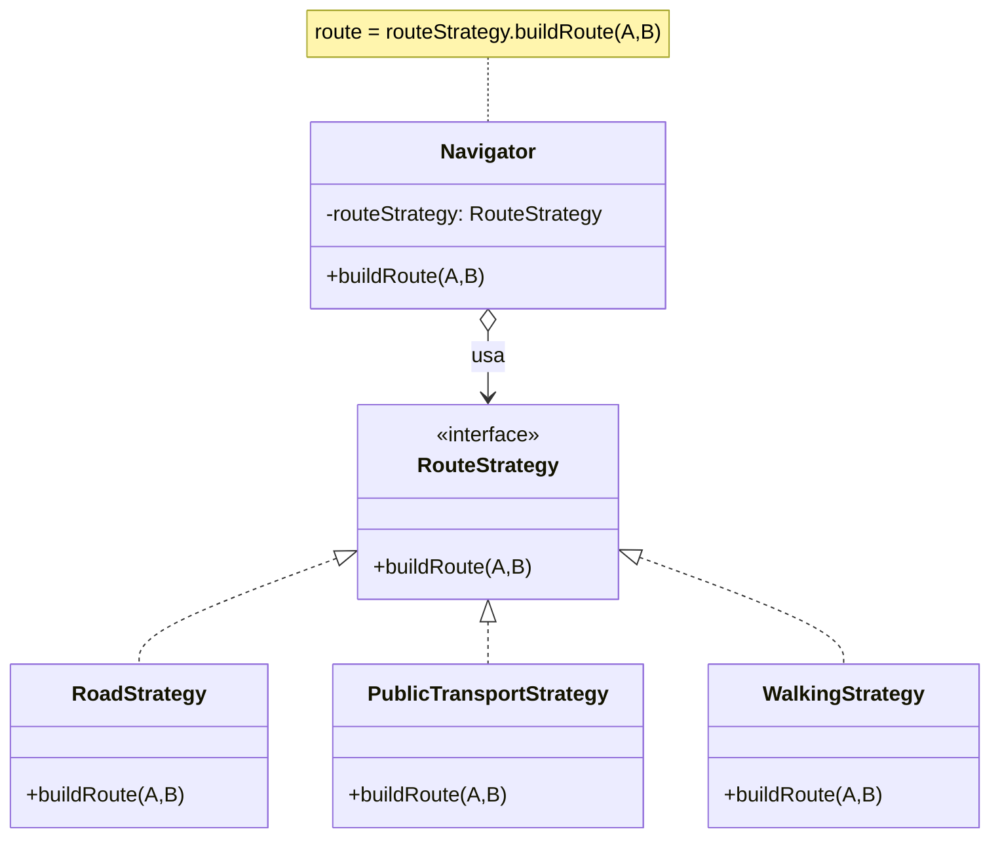
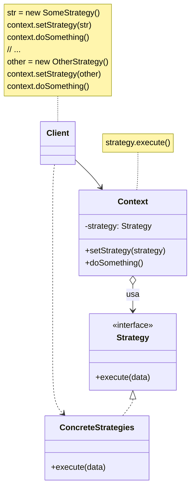

---

tipo: anotacao

periodo: 5

disciplina: Psoft

trilhas:

- Engenharia de Software

---
## Propósito:

O **Strategy** é um padrão de projeto comportamental que permite que você defina uma família de algoritmos, coloque-os em classes separadas, e faça os objetos deles intercambiáveis.

## Problema:

O padrão Strategy sugere que você pegue uma classe que faz algo específico em diversas maneiras diferentes e extraia todos esses algoritmos para  classes separadas chamadas estratégias.

A classe original, chamada **contexto**, deve ter um campo para armazenar uma referência para uma desses estratégias(concretas). **O contexto delega o trabalho para o objeto estrátegia** ao invés de executá-lo por conta própria.

O **contexto** não é responsável por selecionar um algoritmo apropriado para o trabalho. Ao invés disso, **o cliente passa a estratégia desejada para o contexto.** Na verdade, o contexto não sabe muito sobre as estratégias. Ele trabalha com todas elas através de uma interface genérica, que somente expõe um único método para acionar o algoritmo encapsulado dentro da estrátegia selecionada.

Dessa forma o contexto se torna independente de estratégias concretas, então você pode adicionar novos algoritmos ou modificar os existentes sem modificar o código do contexto ou outras estratégias.

Para entender os símbolos de interface, herança e relacionamento no diagrama, veja [[Interfaces e classes abstratas]] e [[Relações entre classes]].

## Analogia com o mundo real:

Imagine que você tem que chegar ao aeroporto. Você pode pegar um ônibus, pedir um táxi, ou subir em sua bicicleta. Essas são suas estratégias de transporte. **Você pode escolher uma das estratégias** (Client) dependendo de fatores como orçamento ou restrições de tempo.

## Estrutura: 

1. O **Contexto** mantém uma referência para uma das estrátegias concretas e se comunica com esse objeto através da interface da estratégia
2. A interface **Estratégia** é comum à todas as estratégias concretas. Ela declara um método que o contexto usa para executar uma estratégia.
3. **Estratégias Concretas** implementam diferentes variações de um algoritmo que o contexto usa.
4. O **contexto** chama o método de execução no objeto estratégia ligado cada vez que ele precisa rodar um algoritmo. o contexto não sabe qual tipo de estratégia ele está trabalhando ou como o algoritmo é executado. 
5. O **Cliente** cria um objeto estratégia específico e passa ele para o contexto. O contexto expõe um setter que permite o cliente mudar a estratégia associada com o contexto durante a execução.

## Como implementar:

1. Na classe contexto, identifique um algoritmo que é sujeito a frequentes mudanças. Pode ser também uma condicional enorme que seleciona e executa uma variante do mesmo algoritmo durante a execução do programa.
2. Declare a interface da estratégia comum para todas as variantes do algoritmo.
3. Um por um, extraia todos os algoritmos para suas próprias classes. Elas devem todas implementar a interface estratégia.
4. Na classe contexto, adicione um campo para armazenar uma referência a um objeto estratégia. Forneça um setter para substituir valores daquele campo. O contexto deve trabalhar com o objeto estratégia somente através da interface estratégia. O contexto pode definir uma interface que deixa a estratégia acessar seus dados.
5. Os Clientes do contexto devem associá-lo com uma estratégia apropriada que coincide com a maneira que esperam que o contexto atue em seu trabalho primário.

| Prós                                                                                     | Contras                                                                                                                                                                                                                                                                                                                                            |
| ---------------------------------------------------------------------------------------- | -------------------------------------------------------------------------------------------------------------------------------------------------------------------------------------------------------------------------------------------------------------------------------------------------------------------------------------------------- |
| Você pode trocar algoritmos usados dentro de um objeto durante a execução.               | Se você só tem um par de algoritmos e eles raramente mudam, não há motivo real para deixar o programa mais complicado com novas classes e interfaces que vêm junto com o padrão.                                                                                                                                                                   |
| Você pode isolar os detalhes de implementação de um algoritmo do código que usa ele.     | Os Clientes devem estar cientes das diferenças entre as estratégias para serem capazes de selecionar a adequada.                                                                                                                                                                                                                                   |
| Você pode substituir a herança por composição.                                           | Muitas linguagens de programação modernas tem suporte do tipo funcional que permite que você implemente diferentes versões de um algoritmo dentro de um conjunto de funções anônimas. Então você poderia usar essas funções exatamente como se estivesse usando objetos estratégia, mas sem inchar seu código com classes e interfaces adicionais. |
| _Princípio aberto/fechado_. Você pode introduzir novas estratégias sem mudar o contexto. |                                                                                                                                                                                                                                                                                                                                                    |

> [!cite] Fonte:
> https://refactoring.guru/pt-br/design-patterns/strategy
